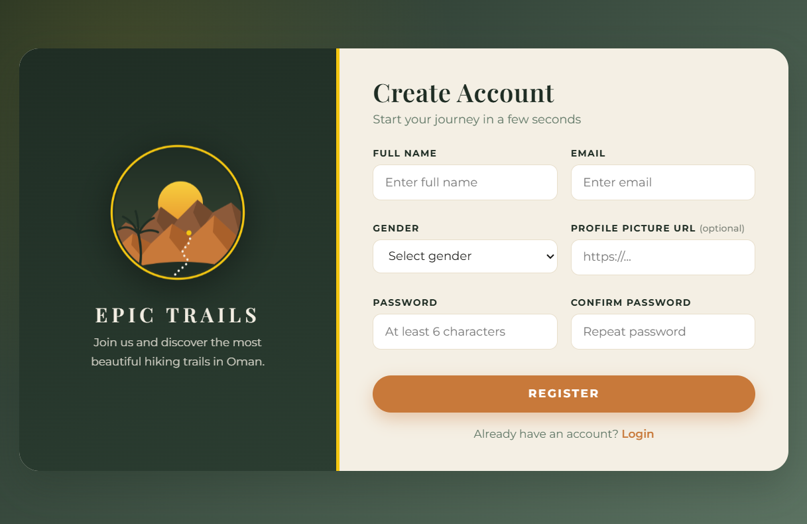
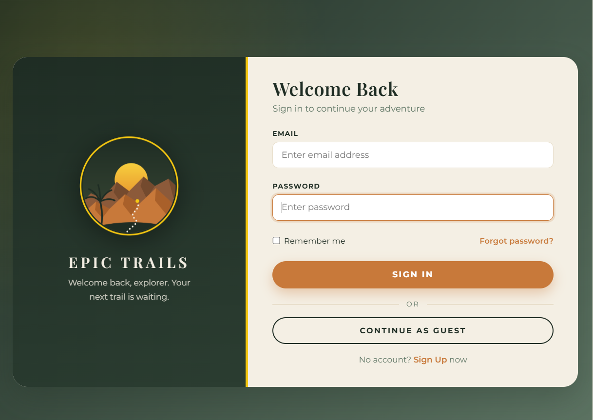
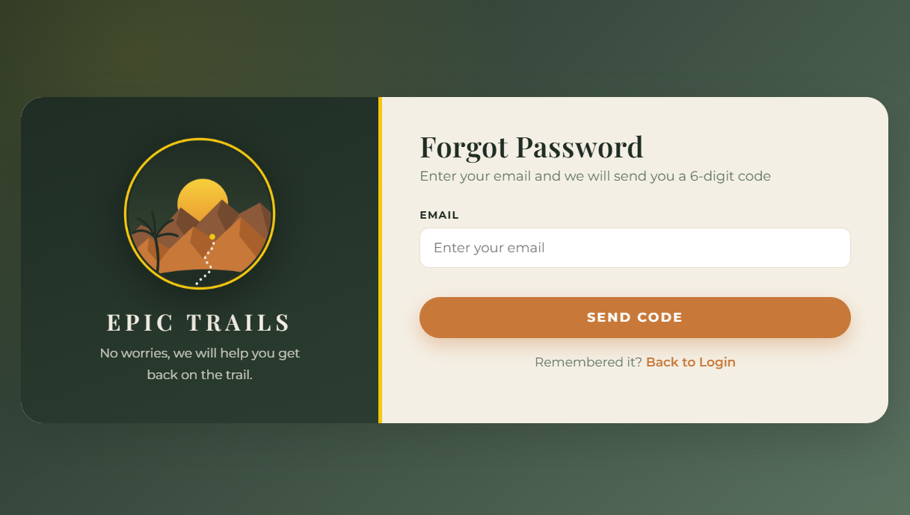
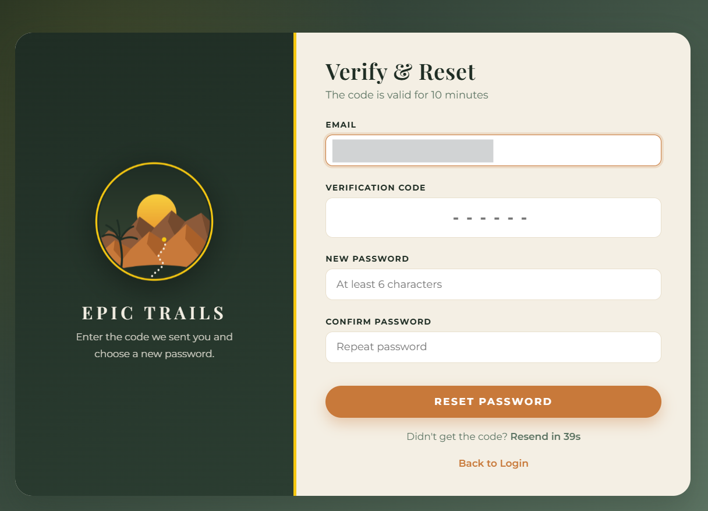
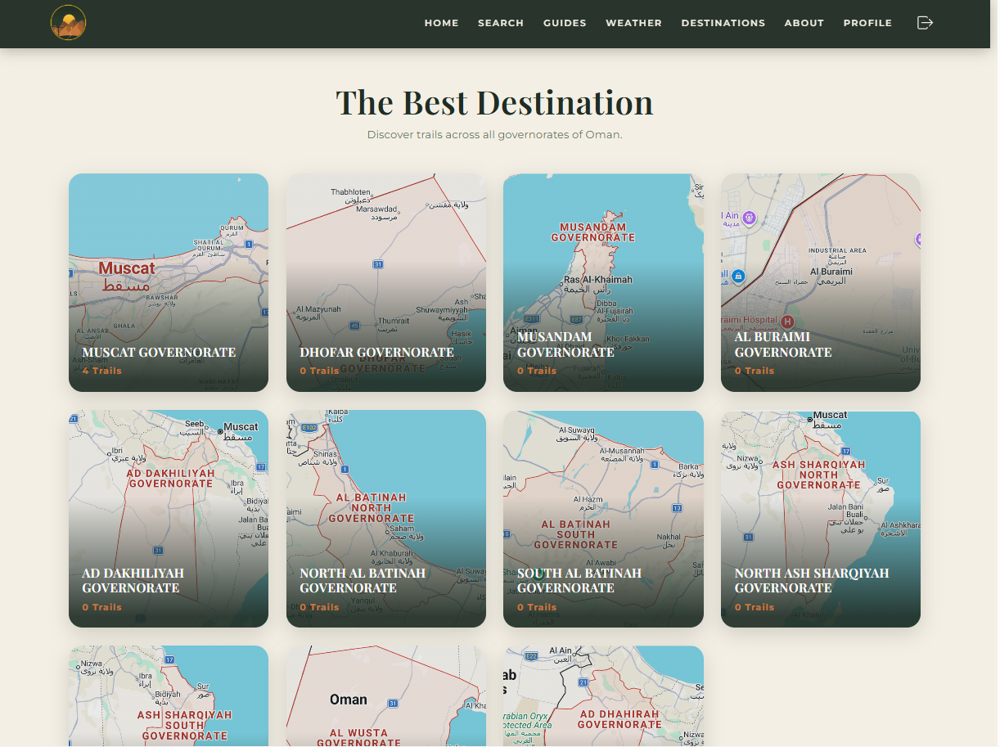
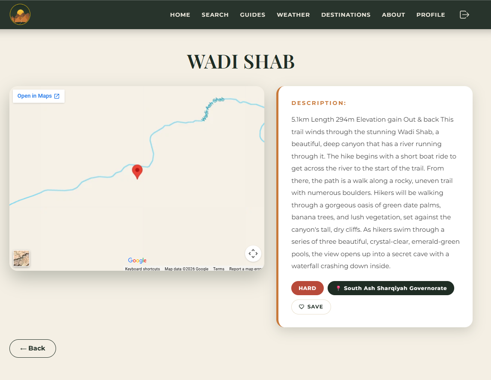
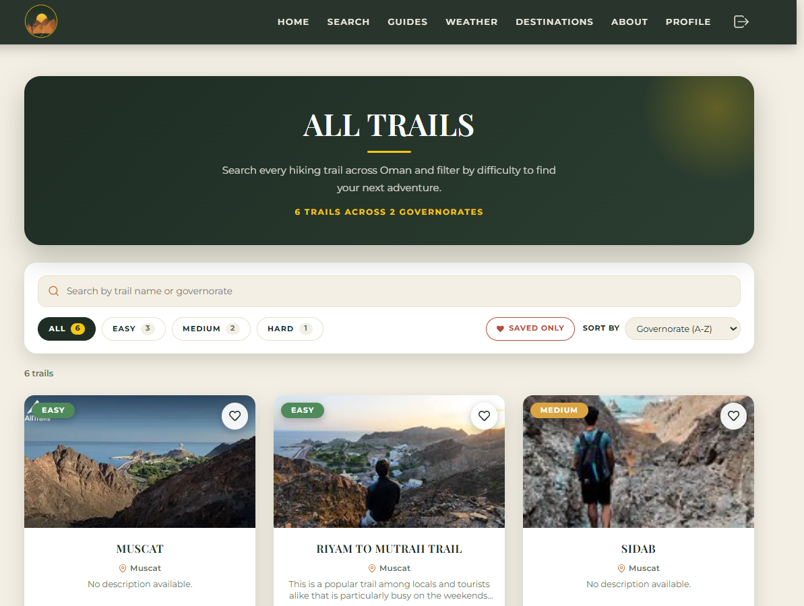
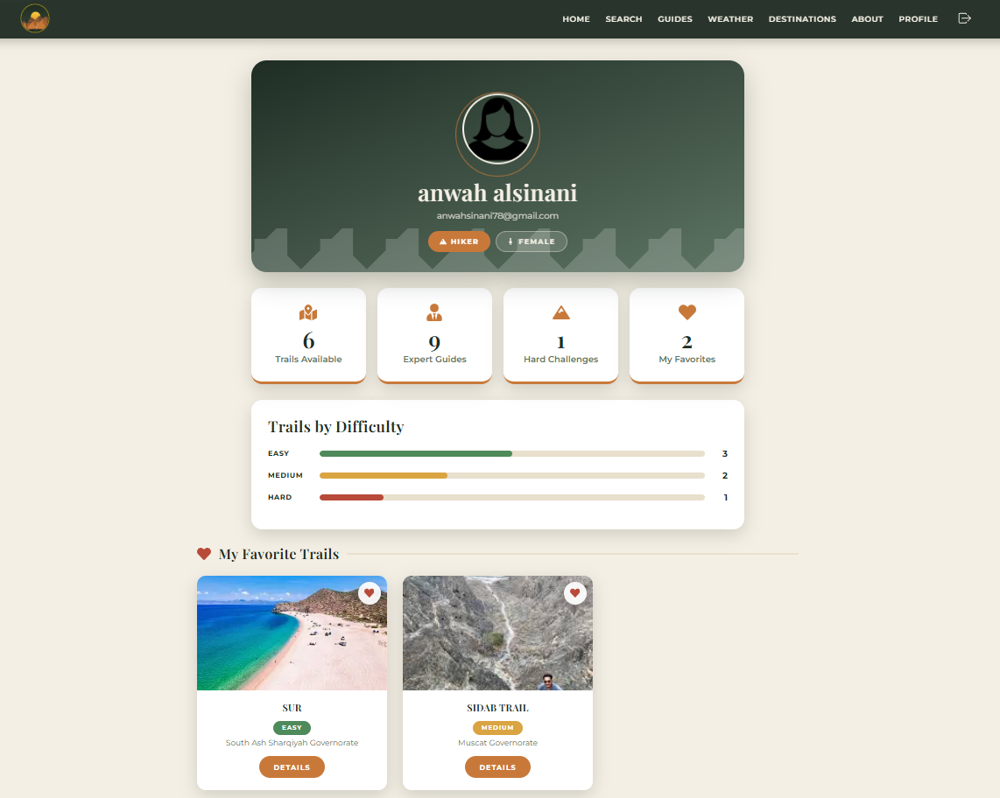
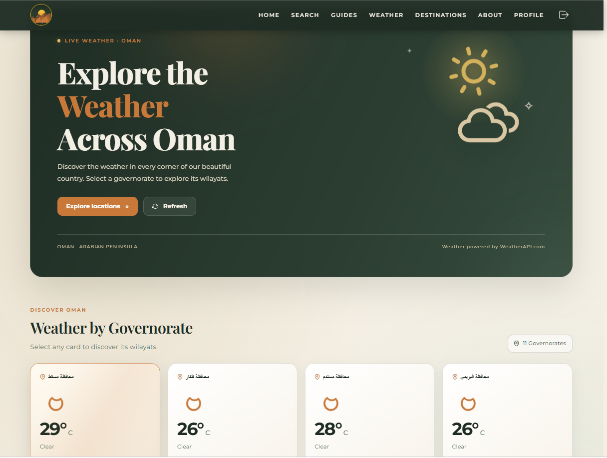
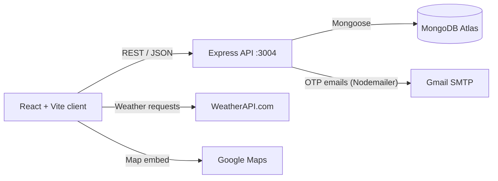

<div align="center">

# 🏔️ Epic Trails

**Discover the most beautiful hiking trails in the Sultanate of Oman.**

A full-stack web platform for exploring trails across all 11 governorates, meeting local guides and checking live weather, with a complete admin dashboard.













*Full-Stack Development course project*

</div>

---

## Table of Contents

- [About the Project](#about-the-project)
- [Features](#features)
- [Tech Stack](#tech-stack)
- [Architecture](#architecture)
- [Project Structure](#project-structure)
- [Getting Started](#getting-started)
- [Environment Variables](#environment-variables)
- [Application Routes](#application-routes)
- [API Reference](#api-reference)
- [Data Models](#data-models)
- [Security](#security)
- [Design System](#design-system)
- [Roadmap](#roadmap)
- [Author](#author)

---

## About the Project

Epic Trails was built as a **Full-Stack Development course project**. It covers the complete stack: a React single-page application, a REST API built with Express, and a MongoDB database, together with authentication, email verification, third-party API integration and an admin panel.

The idea is simple: Oman has remarkable mountain, wadi and coastal trails, but they are hard to find in one place. Epic Trails lets hikers browse trails by governorate or difficulty, view each trail on a map, find a guide and check the weather before heading out. Administrators manage all the content through a dedicated dashboard.

<!--
Add screenshots here, for example:

| Home | Trail Details |
|---|---|
|  |  |

| Weather | Admin Dashboard |
|---|---|
|  |  |
-->

---

## Features

### For hikers

| Feature | Description |
|---|---|
| **Browse by governorate** | Cards for all 11 governorates of Oman with a live trail count for each |
| **Search by difficulty** | Filter trails by Easy, Medium or Hard |
| **Trail details** | Description, difficulty badge, governorate and an embedded Google Map based on the trail's coordinates |
| **Hiking guides** | Guide profiles with specialty and contact details |
| **Live weather** | Current weather for every governorate and its wilayats, with refresh, loading and error states (WeatherAPI.com) |
| **Authentication** | Registration and login with bcrypt-hashed passwords |
| **Password recovery (OTP)** | A 6-digit verification code is sent by email to reset a forgotten password |
| **Favorite trails** | Heart button on every trail card and on the trail page; saved trails are stored on the user's account and listed on the profile page |
| **Profile page** | Avatar chosen by gender, animated statistics, a trails-by-difficulty chart and the saved favorite trails |
| **Guest mode** | Browse the whole site without an account; profile access is hidden and protected |
| **Animations** | Scroll-reveal cards, animated counters and floating elements, with `prefers-reduced-motion` support |
| **Responsive design** | Layouts adapt from desktop down to small mobile screens |

### For administrators

| Feature | Description |
|---|---|
| **Dashboard** | Live statistics for total trails, guides and registered users |
| **Trail management** | Add, edit and delete trails (with coordinates, level, governorate and image) |
| **Guide management** | Add, edit and delete guides, with automatic default avatar by gender |
| **Safe deletion** | Confirmation prompt before any delete action |

---

## Tech Stack

| Layer | Technologies |
|---|---|
| **Frontend** | React, Vite, Redux Toolkit, React Router, reactstrap, React Hook Form, Yup, Axios, React Icons |
| **Backend** | Node.js, Express, Mongoose, bcrypt, Nodemailer, CORS, dotenv |
| **Database** | MongoDB Atlas |
| **External services** | WeatherAPI.com (weather), Gmail SMTP (verification emails), Google Maps embed (trail location) |
| **Styling** | Custom CSS with design tokens, Playfair Display and Montserrat |

---

## Architecture



- The **client** keeps trails, guides and the user session in Redux slices (`UserSlice`, `TrailSlice`, `GuideSlice`, `FavoriteSlice`) and talks to the API with Axios.
- The **server** exposes REST endpoints, hashes passwords with bcrypt and sends verification codes through Nodemailer.
- **MongoDB** stores users, trails and guides in three collections.

---

## Project Structure

```
epic-trails/
├── client/                      # React frontend (Vite)
│   ├── public/
│   └── src/
│       ├── assets/              # logo, governorate images, avatars
│       ├── components/          # pages and reusable UI components
│       │   ├── Home.jsx, MainPage.jsx, Search.jsx, Guides.jsx
│       │   ├── Weather.jsx, TrailDetails.jsx, Profile.jsx
│       │   ├── Login.jsx, Register.jsx
│       │   ├── ForgotPassword.jsx, ResetPassword.jsx
│       │   ├── AdminDashboard.jsx, ManageTrails.jsx, ManageGuides.jsx
│       │   ├── AddTrail.jsx, EditTrail.jsx, AddGuide.jsx, EditGuide.jsx
│       │   └── Navbar.jsx, AdminNavbar.jsx, Footer.jsx, Reveal.jsx, FavoriteButton.jsx
│       ├── features/            # Redux slices (User, Trail, Guide, Favorite)
│       ├── style/               # CSS files per page/component
│       ├── validations/         # Yup schemas (login, register)
│       ├── _test_/              # tests for Redux slices
│       ├── App.jsx
│       └── store.js
└── server/                      # Express backend
    ├── models/                  # Mongoose models (Users, Trails, Guides)
    └── index.js                 # API routes
```

---

## Getting Started

### Prerequisites

- **Node.js 18** or later
- A **MongoDB** database (a free [MongoDB Atlas](https://www.mongodb.com/atlas) cluster works)
- A **WeatherAPI.com** key, from a free account at [weatherapi.com](https://www.weatherapi.com/)
- *(Optional)* A **Gmail** account with an [App Password](https://myaccount.google.com/apppasswords) to send verification codes

### 1. Clone the repository

```bash
git clone https://github.com/anwah304/epic-trails.git
cd epic-trails
```

### 2. Set up and run the server

```bash
cd server
npm install
```

Create a `server/.env` file (see [Environment Variables](#environment-variables)), then start the API:

```bash
node index.js
```

The API runs on **http://localhost:3004**.

### 3. Set up and run the client

Open a second terminal:

```bash
cd client
npm install
```

Create a `client/.env` file with your weather key, then start the app:

```bash
npm run dev
```

The app runs on **http://localhost:5173**.

### 4. Create an admin account

Register a normal account from the app, then change its `role` field from `"user"` to `"admin"` in your MongoDB `Users` collection. Logging in with that account opens the admin dashboard.

---

## Environment Variables

The client and the server each have **their own** `.env` file. Both are ignored by Git.

### `server/.env`

| Variable | Required | Description |
|---|---|---|
| `MONGO_URI` | Yes | MongoDB connection string |
| `CLIENT_URL` | Yes | Frontend address (default `http://localhost:5173`) |
| `EMAIL_USER` | For OTP emails | Gmail address that sends the verification codes |
| `EMAIL_PASS` | For OTP emails | Gmail **App Password** (not your account password) |

```env
MONGO_URI=your_mongodb_connection_string
CLIENT_URL=http://localhost:5173
EMAIL_USER=youremail@gmail.com
EMAIL_PASS=your_16_character_app_password
```

### `client/.env`

| Variable | Required | Description |
|---|---|---|
| `VITE_WEATHER_API_KEY` | Yes | WeatherAPI.com key used by the Weather page |

```env
VITE_WEATHER_API_KEY=your_weatherapi_key
```

> Vite reads `.env` from the client root (next to `package.json`), and only variables prefixed with `VITE_` reach the browser. Restart `npm run dev` after editing it.

---

## Application Routes

| Path | Page | Access |
|---|---|---|
| `/` | Landing page | Public |
| `/login`, `/register` | Authentication | Public |
| `/forgot-password`, `/reset-password` | Password recovery with email OTP | Public |
| `/home` | Governorates overview | Public / guest |
| `/governorate/:name` | Trails in one governorate | Public / guest |
| `/search` | Search trails by difficulty | Public / guest |
| `/trail/:id` | Trail details and map | Public / guest |
| `/guides`, `/weather`, `/destinations`, `/about` | Content pages | Public / guest |
| `/profile` | User profile | Logged-in users (guests are redirected to login) |
| `/admin`, `/admin/trails`, `/admin/guides` | Admin dashboard and management | Admin |
| `/add-trail`, `/edit-trail/:id`, `/add-guide`, `/edit-guide/:id` | Admin forms | Admin |

---

## API Reference

Base URL: `http://localhost:3004`

### Authentication and users

| Method | Endpoint | Description |
|---|---|---|
| POST | `/register` | Create an account |
| POST | `/login` | Sign in and return the user (without password) |
| POST | `/forgot-password` | Send a 6-digit verification code to the email |
| POST | `/reset-password` | Verify the code and set a new password |
| GET | `/Users` | List users (password and reset fields excluded) |
| GET | `/usersCount` | Number of registered (non-admin) users |

### Favorites

| Method | Endpoint | Description |
|---|---|---|
| GET | `/favorites/:userId` | Get the IDs of a user's favorite trails |
| POST | `/favorites/toggle` | Add or remove a trail from a user's favorites (`{ userId, trailId }`) |

Deleting a trail also removes it from every user's favorites.

### Trails

| Method | Endpoint | Description |
|---|---|---|
| GET | `/getTrails` | List all trails |
| POST | `/addTrail` | Add a trail |
| PUT | `/editTrail/:id` | Update a trail |
| DELETE | `/deleteTrail/:id` | Delete a trail |

### Guides

| Method | Endpoint | Description |
|---|---|---|
| GET | `/getGuides` | List all guides |
| POST | `/addGuide` | Add a guide |
| PUT | `/editGuide/:id` | Update a guide |
| DELETE | `/deleteGuide/:id` | Delete a guide |

---

## Data Models

**Users**

| Field | Type | Notes |
|---|---|---|
| `email` | String | Required, unique |
| `username` | String | Required |
| `password` | String | Required, bcrypt hash |
| `gender` | String | `Male` or `Female`, selects the default avatar |
| `profilepic` | String | Optional image URL |
| `role` | String | `user` (default) or `admin` |
| `favorites` | [String] | IDs of the trails the user saved |
| `resetPasswordToken` | String | Hashed OTP, temporary |
| `resetPasswordExpires` | Date | OTP expiry time |
| `resetPasswordAttempts` | Number | Wrong-code counter |

**Trails**

| Field | Type |
|---|---|
| `name`, `description`, `image` | String |
| `level` | `EASY`, `MEDIUM` or `HARD` |
| `governorate` | One of the 11 governorates |
| `lat`, `lng` | Coordinates used for the map |

**Guides**

| Field | Type |
|---|---|
| `name`, `specialty`, `phone`, `email`, `description`, `image` | String |
| `gender` | `Male` or `Female` |

---

## Security

| Area | Implementation |
|---|---|
| **Passwords** | Hashed with bcrypt (10 salt rounds), never returned by the API |
| **OTP reset** | Random 6-digit code generated with `crypto.randomInt`, stored hashed, valid for 10 minutes |
| **Brute-force protection** | The code is invalidated after 5 wrong attempts; resend is limited to once per minute |
| **Account privacy** | The reset endpoint gives the same response whether or not the email exists |
| **Secrets** | Database URI and email credentials live in `server/.env`, which is git-ignored |
| **Guest mode** | `/profile` redirects guests to the login page |

---

## Design System

| Token | Value | Use |
|---|---|---|
| Forest | `#1f2d24` | Navigation, footer, dark surfaces |
| Moss | `#5d7463` | Secondary text and accents |
| Sand | `#f4efe4` | Page backgrounds |
| Sunset | `#c8793a` | Buttons and highlights |
| Gold | `#f5c711` | Accent lines and badges |
| Fonts | Playfair Display, Montserrat | Headings and body text |

The logo and palette are inspired by Oman's Hajar mountains: warm rock tones, a golden sun and date palms.

---

## Roadmap

- [x] Browse trails by governorate and difficulty
- [x] Trail details with embedded map
- [x] Authentication, guest mode and profile
- [x] Live weather by governorate and wilayat
- [x] Password recovery with email OTP
- [x] Admin dashboard with full trail and guide management
- [x] Favorite trails saved to each user's profile
- [ ] Protect admin routes with JWT and role checks on the server
- [ ] Move weather requests behind the server to keep the API key private
- [ ] Reviews and ratings for trails
- [ ] Deploy the application online

---

## Author

**Anwah Ibrahim AL-Sinani**

Designed and developed as a Full-Stack Development course project.

GitHub: [@anwah304](https://github.com/anwah304)